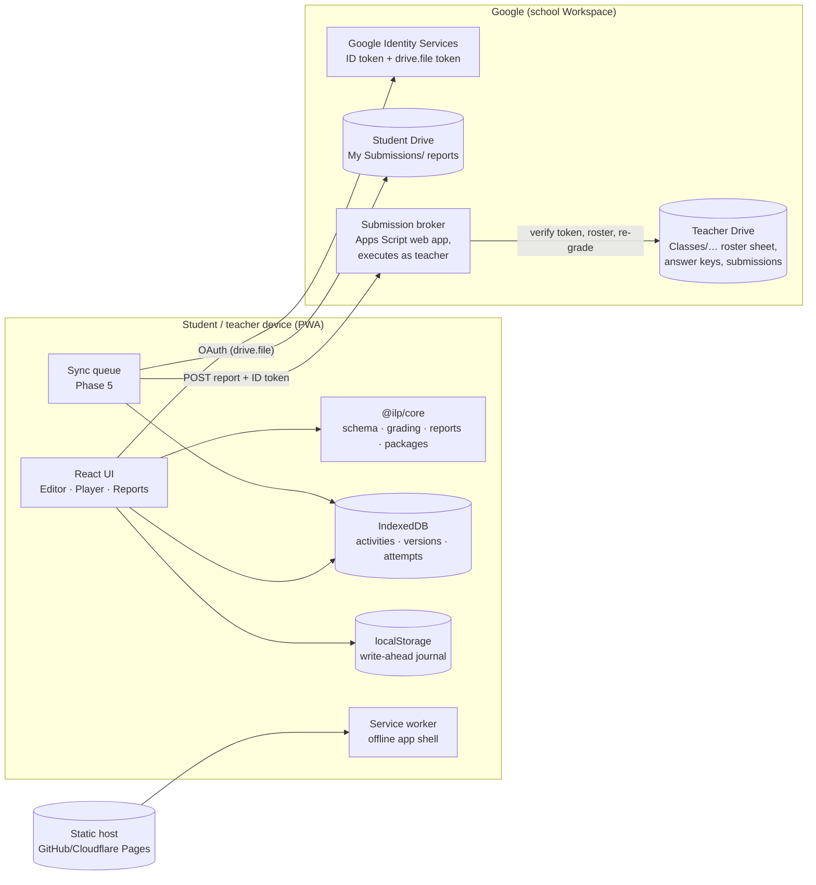
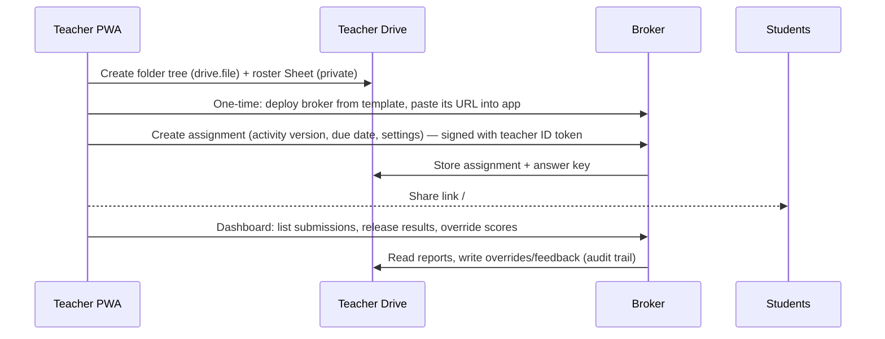

# 3–4. Software architecture and interaction diagrams

## Principles

- **Local-first.** Every edit and every keystroke is written to the device first (IndexedDB + a synchronous localStorage write-ahead journal). Network operations are a sync layer on top.
- **One grading engine.** `@ilp/core` is framework-free TypeScript: schemas (zod), item definitions, deterministic grading, reports, packages. The browser uses it to grade; the broker uses the **same compiled bundle** to re-grade and verify.
- **Plugins.** A question type = a core `ItemDefinition` (schema, grade, validate, describe) + a UI `ItemPlugin` (Editor, Player). Nothing else changes.
- **No central student database.** Rosters, bindings and submissions live in the teacher's Google Drive. The optional broker runs *as the teacher*, inside the teacher's account.
- **Static hosting.** Hash routing, service-worker precache, strict CSP.

## Components



## Secure student → teacher submission (recommended design)

The question the spec asks first: *can a student's token create files for the teacher?* No. A student's OAuth token can only act as the student. Three options were evaluated:

| Option | How | Pros | Cons |
|---|---|---|---|
| **1. Share-only** (no backend) | Student app creates report in student Drive (`drive.file`), then `permissions.create` gives the teacher reader access | Zero infrastructure | File stays student-owned (student can edit/delete it); lands in teacher's "Shared with me", not organised; teacher's app can't list it with `drive.file` without the Picker; scores are client-computed (forgeable); student can share with any email |
| **2. Per-student folders** | Teacher app creates `Submissions/<student#>/` per student, shares each with that student | Students can't see each other | Files created by students are owned by students (in My Drive); student must pick the folder once via Picker (`drive.file`); still client-graded; N folders to manage |
| **3. Per-teacher broker (recommended)** | Apps Script web app deployed from a template **by each teacher**, "Execute as: me", "Who has access: anyone"; student POSTs raw responses + Google ID token | Teacher-owned durable copies; organised folders by class/assignment; server-side roster check & re-grade; answer keys never leave teacher's Drive; server timestamp; idempotent duplicate handling; no infrastructure we run | Teacher does a one-time setup; Apps Script quotas; Workspace admin may need to allow it |

The broker also supports a central **Cloudflare Worker** variant (same API) for districts that prefer one deployment; that variant stores only encrypted teacher refresh tokens and hashed bindings — never names or responses.

```mermaid
sequenceDiagram
  autonumber
  participant S as Student PWA
  participant G as Google Identity
  participant SD as Student Drive
  participant B as Broker (Apps Script, runs as teacher)
  participant TD as Teacher Drive
  S->>G: Sign in (openid email + drive.file)
  G-->>S: ID token (sub, email, hd) + access token
  S->>B: GET assignment (ID token)
  B->>G: tokeninfo(ID token) → verify aud, iss, exp, email_verified, hd
  B->>TD: Roster sheet: email→student#, bind sub on first use
  B-->>S: Activity version (answer keys stripped if server-graded)
  Note over S: Student works offline-capable; autosave to IndexedDB
  S->>SD: Save report JSON + PDF (student-owned copy)
  S->>B: POST submission {assignmentId, attemptId, responses, clientReport, ID token}
  B->>B: Verify token + roster + deadline + attempt limit + idempotency (attemptId)
  B->>B: Re-grade with @ilp/core using teacher-held key
  B->>TD: Write teacher-owned report in Classes/<class>/Student Reports/<assignment>/<student#>-<attemptId>.json
  B-->>S: Receipt {serverScore, receivedAt, receiptId, HMAC}
  S->>S: Mark attempt "synced"; show both confirmations
```

### Why the ID token is verified via `tokeninfo`
Apps Script cannot verify RS256 signatures natively; calling `https://oauth2.googleapis.com/tokeninfo?id_token=…` (one UrlFetch per request) is Google's documented verification path for low volume. The broker checks `aud` = our OAuth client ID, `iss`, `exp`, `email_verified`, and `hd` (school domain) when configured.

## Teacher flow



## Runtime layers in the web app

| Layer | Folder | Notes |
|---|---|---|
| Routes/shell | `apps/web/src/app` | Hash router, header, settings, update banner |
| Teacher | `apps/web/src/teacher` | Library, editor, previews |
| Student | `apps/web/src/student` | Home, player, results |
| Plugins | `apps/web/src/plugins/<type>` | Editor + Player per type |
| Storage | `apps/web/src/storage` | IndexedDB repositories, journal, import/export |
| Sync (Phase 5) | `apps/web/src/sync` | Queue, Drive client, broker client |
| Core | `packages/core` | Shared with broker |

## Safe rendering
Phase 1 renders all teacher text as **text** (React escaping) — no HTML. Rich text (Phase 2+) will use a constrained Markdown subset rendered to a whitelist via DOMPurify; images/audio only from the package or `blob:` URLs; external links open with `rel="noopener noreferrer"`. Production CSP: `default-src 'self'`, no inline script, `object-src 'none'`.
