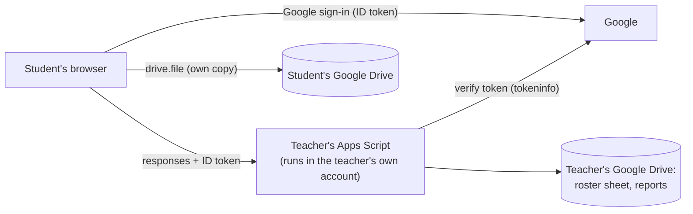

# 13. IT review packet (draft — for the school's IT / privacy officer)

**What it is:** an open-source (MIT) web app for interactive classroom activities (similar to H5P). Hosted as static files on GitHub Pages. No company server, no central database, no advertising, no analytics.

## Data flow

## Google permissions requested by the app (OAuth client)
| Scope | Classification | Why |
|---|---|---|
| `openid`, `userinfo.email` | non-sensitive | Identify the user to the teacher's service |
| `drive.file` | non-sensitive | Save the user's own reports; open files the user explicitly picks. **No access to any other Drive files.** |

The teacher's Apps Script (installed by each teacher in their own account) uses Drive, Sheets and one external request (`oauth2.googleapis.com/tokeninfo`) to store submissions in that teacher's Drive.

## Personal information
| Data | Where | Visible to |
|---|---|---|
| Roster: student number, optional name, school email, Google account id | Private sheet in the teacher's Drive | Teacher only |
| Student work & reports (student number only, no name/email) | Teacher's Drive; student's own Drive | Teacher; the student |
| Voice recordings | Student device by default (auto-deleted after 14 days / on submit); in the teacher's Drive only when an assignment requires submission | Student; teacher |
| Anything else | — | Nobody: the app has no server |

Pseudonymous student numbers are still personal information because the teacher can re-identify them; retention and deletion are controlled by the teacher in Drive.

## Security controls (summary)
- Students cannot choose a student number: the service links it to the verified Google account (`sub`) on first use; a different account cannot take it over later.
- Every request is verified by Google's token endpoint (audience = this app's client id); optional school-domain restriction (`ALLOWED_DOMAIN`).
- Server-side re-grading of raw responses; tampered client scores are flagged; receipts are HMAC-signed; duplicate submissions are idempotent; attempt limits, due dates and closing are enforced by the service.
- Optional "hidden answer keys" mode: answers never reach student devices.
- Strict Content-Security-Policy; imported documents sanitised; no third-party scripts except Google sign-in/Picker.
- Accessibility: automated WCAG 2.2 AA checks (axe) on all main screens; keyboard alternatives for every drag interaction.

## Requests to IT
1. Allow the OAuth client `964954121204-…apps.googleusercontent.com` for students and teachers (Admin console → Security → API controls → App access control) — or confirm it is already allowed.
2. Allow teachers to run their own Apps Script web apps (or advise on the school's preferred alternative).
3. Advise on parental notice/consent requirements (PIPA: under-14 consent where consent is the legal basis) and the school's software review procedure.
4. Optional: provide the school domain so the service can accept school accounts only.
